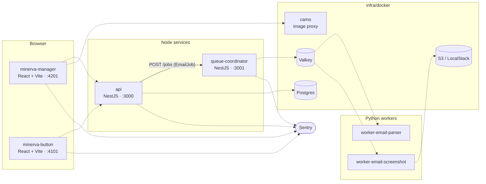
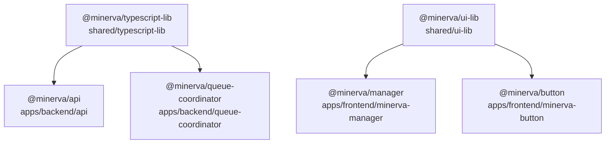

# Minerva

Minerva turns incoming email into structured, reviewable work items. This repository is the
second iteration (`minerva-v2`) and is organised as a **pnpm monorepo** holding two NestJS
services, two React frontends, a shared UI library, a shared TypeScript contract library, and
(outside the pnpm workspace) the Python workers.

The TypeScript side is fully set up — install, build, typecheck, test, lint, Storybook. The
application logic itself is still thin scaffolding: the api accepts a job and hands it to the
queue-coordinator, and the frontends render the ui-lib. The Python workers are placeholders.

---

## Architecture

### Runtime view

Solid arrows are implemented today, dashed arrows are the intended wiring that does not exist yet.



The contract on the `api → queue-coordinator` edge is `EmailJob` from `@minerva/typescript-lib`
(`{ id, kind: 'parse' | 'screenshot', messageId, enqueuedAt }`). Both services import the same
type and the same `isEmailJob` guard, so a change to the payload breaks the build on both sides
rather than at runtime.

### Ports

The frontend dev servers use the `4x01` range so they never collide with the defaults of other
locally running projects (Vite's `5173`, Storybook's `6006`) — several of these can be running at
the same time.

| Port | What | Configured in |
| --- | --- | --- |
| **4101** | minerva-button (dev + preview) | `apps/frontend/minerva-button/vite.config.ts` |
| **4201** | minerva-manager (dev + preview) | `apps/frontend/minerva-manager/vite.config.ts` |
| **4301** | Storybook for the ui-lib | `scripts/storybook-dev.sh` (`STORYBOOK_PORT` overrides) |
| 3000 | api (NestJS) | `API_PORT` in `.env` |
| 3001 | queue-coordinator (NestJS) | `QUEUE_COORDINATOR_PORT` in `.env` |
| 5432 | Postgres | `infra/docker/docker-compose.yml` |
| 6379 | Valkey | `infra/docker/docker-compose.yml` |
| 4566 | LocalStack (S3) | `infra/docker/docker-compose.yml` |
| 8443 | camo image proxy | `infra/docker/docker-compose.yml` |

The three `4x01` ports are served over HTTPS (see [HTTPS in development](#https-in-development));
the docker services bind to `127.0.0.1` only.

### Package view

Arrows are `workspace:*` dependencies. `pnpm -r build` walks this graph in topological order,
which is why the libraries always build before their consumers.



### Repository layout

```
apps/
  backend/
    api/                       @minerva/api                 NestJS · REST entry point
    queue-coordinator/         @minerva/queue-coordinator   NestJS · job intake
    worker-email-parser/       Python (not in the pnpm workspace)
    worker-email-screenshot/   Python (not in the pnpm workspace)
  frontend/
    minerva-manager/           @minerva/manager             React + Vite · :4201
    minerva-button/            @minerva/button              React + Vite · :4101
shared/
  ui-lib/                      @minerva/ui-lib              Mantine + Tabler + Storybook
  typescript-lib/              @minerva/typescript-lib      env helpers + job contracts
  python-lib/                  Python (not in the pnpm workspace)
  assets/                      fonts shared by the apps and Storybook
infra/
  cert/                        mkcert output (gitignored)
  docker/                      docker-compose.yml: postgres, valkey, localstack, camo
bruno/                         API collections
scripts/                       dependency check, env setup, certs, icon generation
biome.json                     formatting + linting for every TypeScript package
pnpm-workspace.yaml            workspace members, version catalog, pnpm settings
tsconfig.base.json             strict base config
tsconfig.backend.json          + decorators (Nest)
tsconfig.web.json              + JSX, DOM libs, verbatimModuleSyntax
vitest.config.ts               root runner, one project per package
vite.https.ts                  shared TLS options for the frontend dev servers
```

---

## How to start

### Prerequisites

Node **26.5.0** (see `.nvmrc`), pnpm **>= 11**, Docker, and GNU make. Run `make check-deps` to
verify all of them at once — it prints the install command for anything missing.

### First time

```sh
make setup        # check-deps → certs → install, in that order
make copy-env     # create .env from .env.template (backs up an existing .env)
make build        # build all six packages in dependency order
```

`make setup` is the composite entry point. It runs the three steps in sequence and stops at the
first one that fails, so a missing tool is reported before anything tries to install against it:

| Step | Target | What it does |
| --- | --- | --- |
| 1 | `make check-deps` | Verifies Homebrew, pnpm, Node, Docker, and make — exits non-zero if any is missing |
| 2 | `make certs` | Generates the mkcert TLS pair, or leaves a still-valid one alone |
| 3 | `make install` | `pnpm install` across the whole workspace |

Each is still a target of its own, so you can re-run just one — `make certs` after a certificate
expires, say — without repeating the rest.

`make copy-env` is deliberately *not* part of `make setup`: it writes a file you are expected to
edit, and re-running it moves your existing `.env` to a timestamped backup. It only copies the
template; every value in it has a working default, so an empty `.env` still boots locally. Sentry
stays disabled while its DSN is empty.

### Day to day

| Command | What it does |
| --- | --- |
| `make dev` | Every app in watch mode — builds the ui-lib first, then runs all packages in parallel |
| `make dev-manager` | Only minerva-manager on <https://localhost:4201> (builds the ui-lib first) |
| `make dev-button` | Only minerva-button on <https://localhost:4101> (builds the ui-lib first) |
| `make storybook` | Storybook for the shared ui-lib on <https://localhost:4301> |
| `make build` | `pnpm -r build` — topological build of all six packages |
| `make test` | The whole Vitest suite (node + jsdom projects) |
| `make typecheck` | `tsc --noEmit` in every package |
| `make lint` | Biome: formatting, import order, and lint rules |
| `make format` | Biome with `--write` — applies formatting and safe fixes |
| `make verify` | lint → typecheck → test, stopping at the first failure |
| `make icons` | Generate PWA/Outlook PNG sizes: `make icons SRC=path/to/source.png [OUT=dir]` |

`make help` lists all targets with their descriptions.

The individual frontend targets build `@minerva/ui-lib` before starting Vite, because the apps
consume the library's `dist/` output rather than its source. If you are changing the ui-lib
itself, either use `make dev` (which keeps `vite build --watch` running alongside the apps) or
`make storybook`, which serves the library straight from source.

Backends run individually with pnpm filters, e.g. `pnpm --filter @minerva/api dev`. VS Code
launch configurations for both services, for Vitest on the current file, and for both frontends
in Chrome are in `.vscode/launch.json`.

### Before pushing

A husky `pre-push` hook (`.husky/pre-push`) runs the full gate on every push — the whole
repository, not just the changed packages:

| Step | Target | On failure |
| --- | --- | --- |
| 1 | `make format` | Cannot fail — formatting is applied, not reported (see below) |
| 2 | `make lint` | Push aborted — Biome found something `--write` cannot fix |
| 3 | `make typecheck` | Push aborted |
| 4 | `make test` | Push aborted |
| 5 | `make build` | Push aborted — a package that typechecks can still fail to bundle |

Formatting is applied rather than rejected, so a stray blank line never blocks a push. Any file
the formatter rewrites **that had no other uncommitted changes** is committed on its own as
`chore: apply biome formatting`. Files you were already editing are left alone — their formatting
is applied in the working tree but not committed, so work in progress is never swept into a commit
you did not write. The commit is made with a pathspec, so anything else already staged stays
staged.

That commit cannot join the push that triggered it: git resolves the ref being pushed *before*
running the hook. So when formatting was committed, the hook finishes the remaining checks and
then exits non-zero with a note to **run your push again** — the second push carries both commits
and passes straight through.

The hook installs itself via the root `prepare` script, so `pnpm install` on a fresh clone is
enough. To bypass it in an emergency: `git push --no-verify`.

### HTTPS in development

All three dev servers run over TLS using the mkcert pair in `infra/cert/`, generated by
`make certs`. One certificate covers `localhost`, `*.localhost`, `127.0.0.1` and `::1`, so every
server can share it — including future `https://<service>.localhost` origins.

`infra/cert/` is gitignored, so a fresh clone has no certificate until `make certs` has run. In
that case the dev servers **fall back to plain HTTP** and print a one-line notice rather than
refusing to boot; run `make certs` and restart to get `https://` back.

The two mechanisms differ because Storybook differs:

| Server | Where TLS is configured |
| --- | --- |
| minerva-manager, minerva-button | `server.https` / `preview.https` in each `vite.config.ts`, loaded from `vite.https.ts` |
| Storybook | `--https --ssl-cert --ssl-key --ssl-ca` flags, passed by `scripts/storybook-dev.sh` |

Storybook runs Vite in *middleware mode* behind its own Node server, so `server.https` in a Vite
config never reaches the listening socket — the certificate has to arrive on the command line
instead. `scripts/storybook-dev.sh` performs the same cert-exists check as `vite.https.ts` so both
paths behave identically.

Enabling TLS also switches the Vite dev servers to **HTTP/2**, which is closer to production than
the HTTP/1.1 they served before.

> **Not wired up yet:** `infra/docker/docker-compose.yml` has no make target, and the credentials
> it requires (`POSTGRES_*`, `VALKEY_PASSWORD`, `S3_BUCKET`, `CAMO_HMAC_KEY`) are not in
> `.env.template`. The dockerised services do not yet use the certificates either — only the
> frontend dev servers and Storybook do.

---

## Architecture decisions

Lightweight ADRs for the choices that shape everything else in the repository.

### ADR-001 — pnpm workspaces as the monorepo tool

**Status:** accepted (2026-07-27)

**Context.** Six TypeScript packages, three of which are libraries consumed by the others, plus
three Python packages that must not be pulled into the Node dependency graph. Minerva v1 used Nx;
its generators and task graph were more machinery than this repository needs, and its config was a
recurring upgrade cost.

**Decision.** Plain pnpm 11 workspaces. Members are listed **explicitly** in
`pnpm-workspace.yaml` rather than with `apps/backend/*` globs, so a Python sibling can never be picked
up by accident. Shared versions live in a `catalog:` with `catalogMode: strict` and
`saveExact: true`; packages depend on `catalog:` instead of literal ranges. Internal dependencies
use `workspace:*`. Every dependency was installed through official pnpm commands
(`pnpm add`, `pnpm dlx`, `pnpm create`, `pnpm pkg set`) — no hand-written version strings.

**Consequences.**

- pnpm's non-flat `node_modules` makes phantom dependencies a hard error, which is what keeps the
  apps from reaching past `@minerva/ui-lib` into Mantine (see ADR-004).
- The catalog guarantees exactly one React, one TypeScript, and one Vite across the workspace.
  Upgrading is a one-line change; a package cannot quietly drift.
- `pnpm -r build` orders builds from the dependency graph, so no separate task runner is needed.
  There is no build caching — accepted for six packages. If the build gets slow, Turborepo can be
  layered on top without changing the workspace.
- TypeScript project references were deliberately **not** used: `composite` conflicts with the
  `noEmit` configuration the Vite packages need, and pnpm already provides the ordering that
  references would buy.
- pnpm 10+ blocks postinstall scripts; the ones this repo needs (`@swc/core`, `esbuild`) are
  recorded in `pnpm-workspace.yaml` via `pnpm approve-builds`.
- Python packages are managed by their own tooling. `make install` covers the Node side only.

### ADR-002 — Vite for building, Vitest for testing

**Status:** accepted (2026-07-27)

**Context.** Two React applications, one component library that has to ship both a bundle and
type declarations, a Storybook, and two NestJS services. Running one bundler for the apps, another
for the library, and a third test runner per stack is exactly the fragmentation this repository is
trying to avoid.

**Decision.** Vite 8 for both frontends and for the ui-lib in **library mode** (multi-entry, ES
output, React/Mantine/Tabler marked external). Storybook uses the `@storybook/react-vite`
framework, so stories go through the same pipeline as the app. Vitest 4 is the single test runner
for all six packages, configured centrally in the root `vitest.config.ts` via `test.projects` —
`node` environment for the backends and typescript-lib, `jsdom` for the frontends and ui-lib.
The NestJS services keep `nest build` for their production output; Vite is only their test-time
transform.

**Consequences.**

- One mental model and one config language for dev server, production build, Storybook, and tests.
- `pnpm test` from the root runs everything in both environments; a package's own `pnpm test`
  still works standalone.
- The ui-lib's build is `vite build && tsc -p tsconfig.build.json` in that order — Vite wipes
  `dist/`, so emitting declarations first would lose them.
- Vitest cannot read Nest's decorator metadata on its own, so the backend test configs run
  `unplugin-swc` with `emitDecoratorMetadata`. Vite 8 transforms with Oxc, which has to be turned
  off (`oxc: false`) for that plugin to take effect.
- Vitest 4 removed `vitest.workspace.ts`; the equivalent is `test.projects`, which is what the
  root config uses.
- The shared toolchain does *not* extend to the dev server's TLS: Storybook wraps Vite in
  middleware mode, so it needs `--ssl-cert`/`--ssl-key` flags where the apps need `server.https`.
  The certificate-loading logic is shared (`vite.https.ts` and `scripts/storybook-dev.sh` apply the
  same rule); only the delivery mechanism differs. See *HTTPS in development*.

### ADR-003 — Biome for formatting and linting

**Status:** accepted (2026-07-27)

**Context.** ESLint plus Prettier means two tools, two configs, a plugin per framework, and a
plugin to stop them fighting each other — across six packages with different runtimes. Formatting
also has to agree with `.editorconfig`, which the Python side already follows.

**Decision.** A single `@biomejs/biome` binary handles formatting, linting, and import sorting for
every TypeScript package, driven by one root `biome.json`. Indentation and line endings come from
`.editorconfig` (`useEditorconfig: true`). Two `overrides` give frontend and backend the different
rule sets they genuinely need. Prettier and ESLint are listed in `.vscode/extensions.json` under
`unwantedRecommendations`. Python keeps ruff.

**Consequences.**

- One command (`make lint` / `make format`), one dependency, and no formatter-vs-linter conflicts.
  Linting the whole repository takes well under a second.
- The frontend/backend split is functional, not stylistic:
  - the backend override enables `javascript.parser.unsafeParameterDecoratorsEnabled`, without
    which Biome refuses to parse Nest's `@Body() body` parameter decorators;
  - `style/useImportType` is **off** for the backend, because rewriting Nest's DI imports to
    `import type` erases the metadata `emitDecoratorMetadata` depends on — and **error** for the
    frontend, where `verbatimModuleSyntax` requires the opposite;
  - `style/noParameterProperties` is off for the backend (`constructor(private readonly x: X)` is
    the Nest idiom), and the `a11y` rules apply only to the frontend.
- Caveat: `useEditorconfig` reads `indent_style` and `indent_size` but **not** `max_line_length`.
  `lineWidth: 120` is therefore set explicitly in `biome.json` to match `.editorconfig`; the two
  must be changed together.
- Biome's rule coverage is narrower than a fully loaded ESLint setup. Type-aware rules are not
  part of it — `make typecheck` is the safety net for that.

### ADR-004 — Structure by runtime, with shared code behind package boundaries

**Status:** accepted (2026-07-27)

**Context.** Minerva v1 was effectively one application. v2 has two Node services, two frontends,
and two Python workers that all need to agree on the same job payloads and the same visual
language.

**Decision.** The deployable applications live under `apps/`, split by runtime into
`apps/backend/` and `apps/frontend/`; the libraries they share sit at the root in `shared/`,
alongside supporting material in `infra/`, `scripts/`, and `bruno/`. All packages are published
under the `@minerva/*` scope. Anything more than one package needs goes into `shared/`:

- `@minerva/typescript-lib` owns the cross-service contracts (`EmailJob`, the job kinds, the
  runtime guards) and environment helpers.
- `@minerva/ui-lib` owns the design system. The applications do **not** depend on Mantine or
  Tabler directly; they import through the library's subpaths:

  ```ts
  import { MinervaThemeProvider } from '@minerva/ui-lib';
  import { Stack, Title } from '@minerva/ui-lib/primitives';
  import { useDisclosure } from '@minerva/ui-lib/hooks';
  import { IconMail } from '@minerva/ui-lib/icons';
  import '@minerva/ui-lib/styles.css';
  ```

**Consequences.**

- The design system has exactly one version of Mantine and one place to change it. Because pnpm
  does not flatten `node_modules`, an app that imports `@mantine/core` directly fails to resolve —
  the boundary is enforced by the package manager, not by convention.
- The subpaths re-export Mantine wholesale (`export * from '@mantine/core'`), so no one has to
  extend a curated list to use a new component. Tree-shaking still holds: adding all 6237 Tabler
  icons to the export surface moved the manager bundle by 0.5 kB.
- Contract changes are compile errors in both services at once, which is the main reason the
  backends share a library at all.
- Adding a package means editing `pnpm-workspace.yaml`. That is deliberate — it is the same
  mechanism that keeps the Python directories out of the Node graph.
- Python packages sit inside `apps/backend/` and `shared/` for readability, but are wired up
  separately; the pnpm workspace never sees them.
